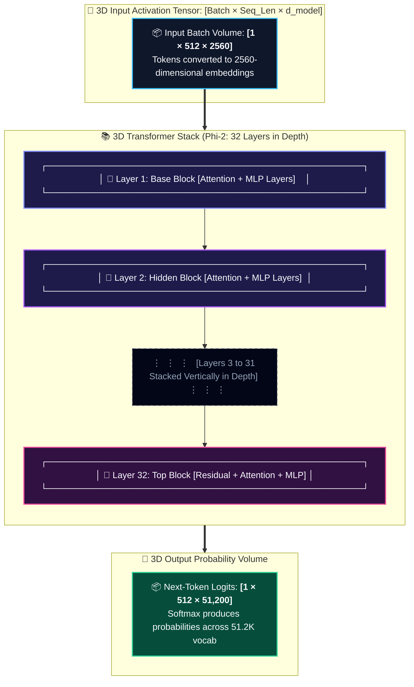
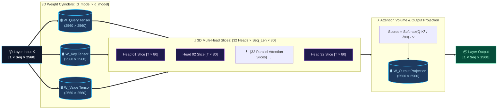
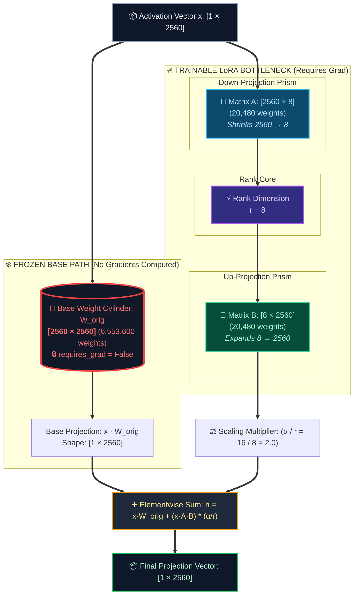
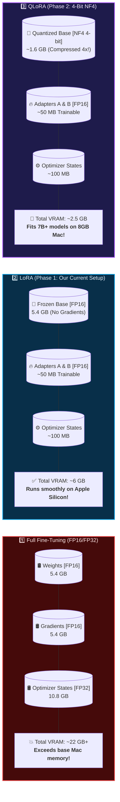

# Phase 1: LoRA Fine-Tuning

> **Prerequisite:** Complete `../00_foundations/` first.

## 🎯 Learning Objectives
By the end of this phase you will:
1. Understand *why* LoRA works (the math intuition)
2. Fine-tune a real model using `peft` + `trl`
3. Have a trained model that extracts fields from payroll text

---

## 📖 Concept: What is LoRA?

**LoRA = Low-Rank Adaptation**

Full fine-tuning updates ALL weights of a model:
- **Phi-2 (2.7B params):** 2.7 **billion** weights to update → ~5.4 GB gradients + ~10.8 GB optimizer states → **~22 GB VRAM required!**
- That exceeds what consumer laptops can train efficiently.

LoRA's insight: **Weight updates have a low "intrinsic dimension"**. We freeze the giant base model and inject two tiny low-rank adapter matrices ($A$ and $B$) alongside each attention projection:

```
FULL FINE-TUNING:
  W_new = W_original + ΔW              ← ΔW has the same massive shape as W_original

LORA:
  W_new = W_original + (A × B) * (α/r) ← A and B are ultra-compact bottleneck matrices!
```

---

### 📐 How Tensor Shapes Vary Across Models

The shape of the weight matrices depends directly on the model's hidden dimension (`d_model`):

| Model | Parameters | Layers | Attention Heads | `d_model` ($D$) | Attention Matrix Shape ($W$) | LoRA $A$ ($D \times r$) | LoRA $B$ ($r \times D$) | Trainable % ($r=8$) |
| :--- | :--- | :--- | :--- | :--- | :--- | :--- | :--- | :--- |
| **GPT-2 Small** | 125M | 12 | 12 | **768** | `(768, 768)` | `(768, 8)` | `(8, 768)` | ~1.04% |
| **Phi-2 (Ours)** ⭐ | 2.7B | 32 | 32 | **2,560** | `(2560, 2560)` | `(2560, 8)` | `(8, 2560)` | **~0.31%** |
| **Mistral 7B** | 7B | 32 | 32 | **4,096** | `(4096, 4096)` | `(4096, 8)` | `(8, 4096)` | ~0.20% |
| **Llama-3 8B** | 8B | 32 | 32 | **4,096** | `(4096, 4096)` | `(4096, 8)` | `(8, 4096)` | ~0.20% |
| **Llama-3 70B** | 70B | 80 | 64 | **8,192** | `(8192, 8192)` | `(8192, 8)` | `(8, 8192)` | ~0.02% |

> Notice: As the base model grows from 2.7B to 70B, **LoRA becomes even more efficient** because the rank $r=8$ stays tiny!

---

### 🧊 3D Isometric View: The Low-Rank Matrix Bottleneck

```
                +------------------------------------+
               /                                    /|
              /         FROZEN BASE WEIGHT         / |
             /             TENSOR CUBE            /  |
            +------------------------------------+   |
            |                                    |   |   d_model
            |             W_original             |   |   (Phi-2: 2560)
            |           (2560 x 2560)            |   +   (Llama: 4096)
            |                                    |  /
            |          6,553,600 params          | /
            |         ❄️ [LOCKED / NO GRADS]     |/  d_model (2560)
            +------------------------------------+
                               +
              +--------+              +------------------------------------+
             /        /|             /                                    /|
            +--------+ |            +------------------------------------+ |
            |   A    | |  r=8       |                 B                  | |  r=8
            | (Down) | | (Bottleneck|             (Up-Proj)              | +
            +--------+/   Prism)    +------------------------------------+/  d_model
            d_model (2560)                       (8 x 2560)                  (2560)
             20,480 params                      20,480 params
             🔥 [TRAINED]                       🔥 [TRAINED, starts @ 0]
```

---

## 🎨 3D Architecture Diagrams

### 1️⃣ 3D Tensor Flow: Input Volume through the 32-Layer Stack



---

### 2️⃣ 3D Multi-Head Attention: Slicing the Hidden Dimension

*Phi-2 has $D=2560$ split across $H=32$ heads. Each head operates on a 3D slice of dimension $d_k = 80$:*



---

### 3️⃣ 3D LoRA Adapter Injection: Frozen Base vs. Trainable Bottleneck

*Gradients bypass the 6.55M parameter frozen base cylinder and only update the 40.9K adapter parameters:*



---

### 4️⃣ 3D Memory & Precision Architecture: Full vs. LoRA vs. QLoRA



---

### The rank (r) hyperparameter:
| r value | Trainable params | Use case |
|---------|-----------------|----------|
| r=4 | Very few | Simple classification, limited training data |
| r=8 | Few (default) | Standard instruction tuning & extraction (our project) |
| r=16 | Moderate | Complex domain adaptation (medical, legal) |
| r=64 | Many | Near full fine-tuning capacity |

### Which layers to apply LoRA to?
```python
target_modules = ["q_proj", "v_proj"]  # Attention query and value projections
# For Phi-2, we also adapt "k_proj" and "dense" for maximum extraction fidelity!
```

---

## 📖 Concept: Instruction Fine-Tuning Format

We're doing **Supervised Fine-Tuning (SFT)** — teaching the model to follow instructions.

Your data must be in **instruction format**:
```json
{
  "instruction": "Extract the following fields from this payroll stub as JSON: employee_name, gross_pay, net_pay, pay_period",
  "input": "ACME Corp - Pay Stub\nEmployee: Maria Garcia\nPeriod: Oct 1-15 2024\nGross: $3,800.00\nFederal Tax: -$570.00\nNet Pay: $3,056.25",
  "output": "{\"employee_name\": \"Maria Garcia\", \"gross_pay\": 3800.00, \"net_pay\": 3056.25, \"pay_period\": \"Oct 1-15 2024\"}"
}
```

The model is trained to look at `instruction + input` and produce `output`.

---

## 🗂️ Files in This Phase

| File | What it teaches |
|------|----------------|
| `01_lora_concepts.py` | Interactive LoRA math demo — see the adapter matrices |
| `02_generate_synthetic_data.py` | Create payroll training data (no real PDFs needed yet!) |
| `03_train_lora.py` | **Main training script** — fine-tune Phi-2 with LoRA |
| `04_inference.py` | Load your trained adapter and test it |
| `05_evaluate.py` | Measure your model's accuracy |
| `data/` | Training and eval datasets |
| `outputs/` | Saved model checkpoints |

---

## 🚀 Quick Start

```bash
# Step 1: Understand LoRA adapters visually
python 01_lora_concepts.py

# Step 2: Generate synthetic payroll training data
python 02_generate_synthetic_data.py

# Step 3: Train! (takes 10-30 min on Apple Silicon M-series)
python 03_train_lora.py

# Step 4: Test your model
python 04_inference.py

# Step 5: Measure accuracy
python 05_evaluate.py
```

---

## 📊 Expected Results

After training on ~200 synthetic payroll samples for 3 epochs:
- **Exact field extraction accuracy:** ~85-92%
- **JSON parsing success rate:** ~95%
- **Training time on M2:** ~15-20 minutes
- **Adapter size on disk:** ~50 MB (vs 5.4 GB for the full model!)

---

## ✅ Phase 1 Checklist

- [ ] Read and understand the LoRA concept above
- [ ] Run `01_lora_concepts.py`
- [ ] Run `02_generate_synthetic_data.py` → inspect `data/train.jsonl`
- [ ] Run `03_train_lora.py` → watch loss go down!
- [ ] Run `04_inference.py` → test your model on new payroll text
- [ ] Run `05_evaluate.py` → see accuracy metrics
- [ ] Move on to `../02_qlora/`
